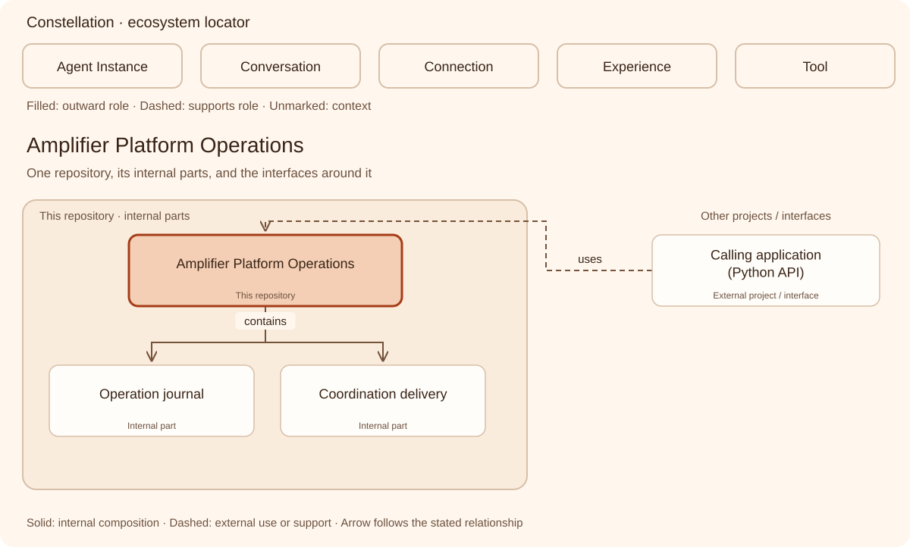

# Operation observations and coordination delivery

This standard-library package records durable operation evidence and provides
bounded coordination delivery. It imports no app, agent engine, provider or UI.

`OperationJournal` owns its SQLite observations, output chunks and retry identities.
Callers supply the conversation, runtime and operation owner identity. Repeated
events preserve their result; conflicting identities or payloads are rejected.
Recovery marks unfinished work unknown without replaying it. Output retention
keeps outcome and deduplication evidence while making expired output explicit.

`coordination` provides attributed peer-input formatting, final-result checks,
bounded UTF-8 delivery with identity-bound cursors, and change notifications.
Applications supply the snapshot and retain authority over admission, permissions,
Stop, cancellation and execution. These helpers do not start or control work.

## Ecosystem map

[Project overview](https://microsoft.github.io/amplifier-constellation/projects/amplifier-platform-operations/) ·
[Open the map](https://github.com/bkrabach/amplifier-platform-operations/blob/main/docs/ecosystem-map.svg) ·
[Map guide](https://github.com/microsoft/amplifier-constellation/blob/main/docs/ecosystem-maps.md)



<details>
<summary>The wider Constellation ecosystem</summary>


</details>

These maps are generated from the [canonical registry](https://github.com/microsoft/amplifier-constellation/blob/main/docs/ecosystem/registry.json).
Update that source and refresh the local maps together; a map is not a release or compatibility claim.

## Build and test independently

From this directory in an owned Python 3.13 or newer environment:

```sh
uv build
uv venv .venv
uv pip install --python .venv/bin/python "dist/amplifier_operations-0.1.0-py3-none-any.whl[test]"
.venv/bin/python -m pytest -q tests
```

On Windows, use `.venv\Scripts\python.exe` for the interpreter paths. The wheel
contains the three runtime files and distribution metadata. The source archive
also contains the standalone tests and synthetic event fixtures. They exercise
restart/unknown outcomes, duplicate ownership, partial output, prospective expiry,
indexed retention pages, cursor recovery and notification ordering without an
application boot, account, network service or sibling checkout.

To verify the installed wheel, copy only `tests/` and this `pyproject.toml` into a
separate directory and run its tests there; do not add the source to `PYTHONPATH`.
The test configuration enables the existing asynchronous notifier check.

## Ownership and delivery

This history-preserving project is prepared as the public standalone author home
at `bkrabach/amplifier-platform-operations`, with a later transfer to Microsoft
planned. [PROVENANCE.json](PROVENANCE.json) maps the original Unified commits,
including the source and tests before their component move. The MIT attribution,
`amplifier-operations` distribution, `amplifier_operations` import, runtime bytes,
and standalone test behavior are unchanged by this handoff.

Unified retains execution, authorization, Stop, cancellation, process ownership
and host integration. Foundation's optional `libraries/operations` has separate
existing API and consumer contracts; this handoff does not replace or reconcile
that implementation.

Use a separate environment for this standalone distribution. Do not coinstall it
with `amplifier-unified`: Unified currently owns its selected installed package
files. Source hosting and author changes do not alter that selection. After the
reviewed authoring handoff, do not maintain competing authored copies.

## Existing artifacts and qualification

Historical Unified releases selected the original 0.1.0 artifact from
[the immutable Unified operations-v0.1.0 release](https://github.com/microsoft/amplifier-unified/releases/tag/operations-v0.1.0).
Those receipts retain their original producer identity; this repository does not
republish or overwrite those bytes. Unified's current selection is recorded in
[`components/operations.source.json`](https://github.com/microsoft/amplifier-unified/blob/main/components/operations.source.json).
A standalone publication does not change it. Unified verifies its generated
selection offline for wheel, source-archive and editable builds; no sibling
checkout or this repository is required by that packaged selection.

The **Operations package** workflow builds one wheel and source archive from an
exact commit, verifies their package inputs and installed metadata, then runs the
existing tests against that wheel outside this checkout on Linux and
Windows/Python 3.13. The copied pytest configuration and `pytest-asyncio` keep the
asynchronous notification check enabled. Pull requests and ordinary pushes qualify
and retain artifacts; they do not publish. Host integration and macOS acceptance
remain separate; package checks do not establish live adoption.

The imported version remains 0.1.0. Before a new publication, coordinate
its version and exact source/artifact receipt with consumers. Unified's later
selection is an explicit reviewed change with a sole installed owner and ordinary
rollback. Newer records, uncertain effects and caller-owned state retain their
authority; neither source handoff nor rollback permits replay. A later repository
transfer should preserve history and releases.

## Publish an exact standalone artifact

After review and merge, manually run **Operations package** on `main` with the
full merged `revision` and `publish: true`. Coordinate one publisher with consumers
first. The workflow builds once and publishes those same verified bytes only
after both installed checks pass. It does not change Unified's selection or an
application's latest release.

The four release assets are the wheel, source archive, `operations-source.json`,
and `SHA256SUMS`. The schema-1 receipt explicitly names `component: operations`,
this repository, `subdirectory: .`, the full commit/root tree, and hashes every
packaged input. The three runtime files remain at the author root and are installed
under `amplifier_operations/`; no source relocation or import alias is needed.
The source archive includes the original tests and fixtures, metadata, license,
and governance/provenance files. Automation and maps are bound by the full source
identity and are not installed runtime code.

`scripts/release.py` owns publication here, adapting the accepted Workspace
Metadata producer's immutable asset and interrupted-draft checks. Historical
Unified releases remain immutable. Consumer selection and rollback stay with
their existing owners, preserving newer operation observations and cursors.

For a failed or cancelled publication, inspect the recorded tag, exact release
ID and original workflow artifacts before explicitly rerunning failed jobs.
Reuse those original artifacts: rebuilding can change archive bytes. A separate
invocation reconciles an existing draft and uploads only missing matching assets;
an exact completed release is read-only. Changed source, tag identity or bytes,
ambiguous release listings and uncertain replies are never overwritten or
automatically retried. A tag lookup that hides a draft does not authorize creating
a duplicate release.

Publication controls run separately from this flat runtime package. From the
repository root, copy only their inputs to a temporary directory so pytest does
not collect the runtime root as a test package:

```sh
controls=$(mktemp -d)
cp -R scripts tests_release "$controls/"
(cd "$controls" && uv run --no-project --with pytest python -m pytest -q tests_release)
rm -r "$controls"
```

## Contributing

> [!NOTE]
> This project is not currently accepting external contributions, but we're actively working toward opening this up. We value community input and look forward to collaborating in the future. For now, feel free to fork and experiment!

Most contributions require you to agree to a
Contributor License Agreement (CLA) declaring that you have the right to, and actually do, grant us
the rights to use your contribution. For details, visit [Contributor License Agreements](https://cla.opensource.microsoft.com).

The Microsoft source contribution requirements remain applicable to changes
intended for transfer upstream. The temporary personal repository does not claim
that a Microsoft CLA bot or other organization automation is already configured.

This project has adopted the [Microsoft Open Source Code of Conduct](https://opensource.microsoft.com/codeofconduct/).
For more information see the [Code of Conduct FAQ](https://opensource.microsoft.com/codeofconduct/faq/) or
contact [opencode@microsoft.com](mailto:opencode@microsoft.com) with any additional questions or comments.

## Trademarks

This project may contain trademarks or logos for projects, products, or services. Authorized use of Microsoft
trademarks or logos is subject to and must follow
[Microsoft's Trademark & Brand Guidelines](https://www.microsoft.com/legal/intellectualproperty/trademarks/usage/general).
Use of Microsoft trademarks or logos in modified versions of this project must not cause confusion or imply Microsoft sponsorship.
Any use of third-party trademarks or logos are subject to those third-party's policies.
